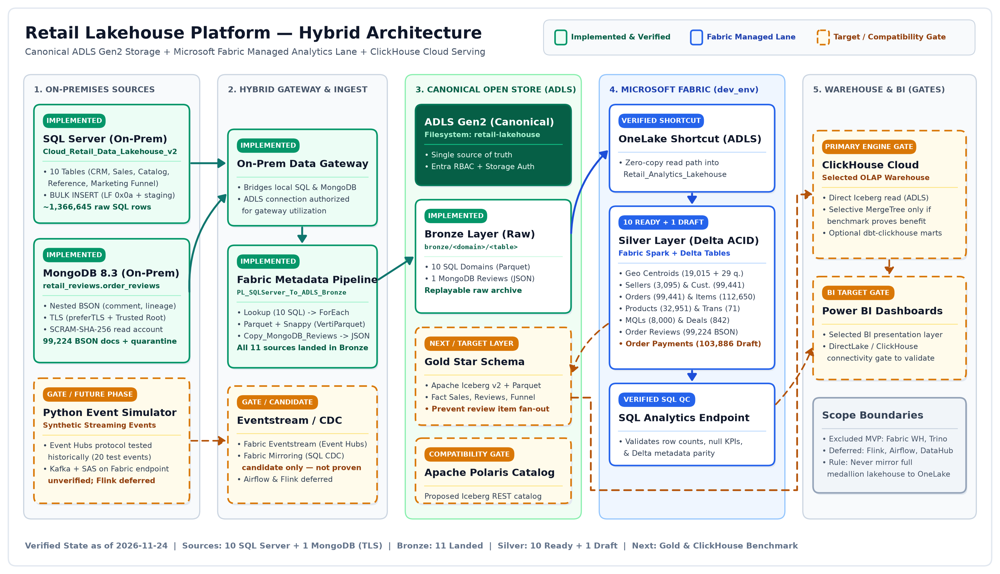

# Retail Lakehouse Platform — Hybrid Medallion Architecture

[](sql/)
[-059669?style=flat-square)](src/ingestion/mongodb_reviews_loader.py)
[](pipelines/)
[](docs/architecture/ARCHITECTURE_BASELINE.md)
[](docs/decisions/ADR-002-clickhouse-cloud.md)

An enterprise-inspired **Hybrid Retail Data Lakehouse** built on **Azure Data Lake Storage Gen2 (ADLS Gen2)** as the canonical physical store, **Microsoft Fabric** as the managed Spark/Pipeline/OneLake analytics lane, and **ClickHouse Cloud** (compatibility-gated) as the primary OLAP serving warehouse.

> **Honest Engineering Boundaries:** This repository clearly separates what is **implemented & verified** today (11-source on-premises ingestion -> Fabric Gateway -> ADLS Gen2 Bronze -> OneLake Shortcut -> Fabric Spark Silver Delta Lake) from **target / compatibility-gate** phases (Gold Iceberg v2 dimensional model, Apache Polaris catalog gate, ClickHouse Cloud direct Iceberg vs. MergeTree benchmark, and Power BI serving).

---

## Architecture Overview



- Editable source diagrams: [`hybrid_lakehouse_architecture.svg`](docs/architecture/diagrams/hybrid_lakehouse_architecture.svg) · [`HYBRID_TARGET_ARCHITECTURE.mmd`](docs/architecture/diagrams/HYBRID_TARGET_ARCHITECTURE.mmd)
- Architecture baseline & ADRs: [`ARCHITECTURE_BASELINE.md`](docs/architecture/ARCHITECTURE_BASELINE.md) · [`DECISION_PRECEDENCE.md`](docs/architecture/DECISION_PRECEDENCE.md) · [`docs/decisions/`](docs/decisions/)
- Preserved legacy planning artifacts (7 Nov 2026): [`LEGACY_README_2026-11-07.md`](docs/reference/LEGACY_README_2026-11-07.md) · [`Blueprint_Digram.png`](docs/Blueprint_Digram.png) · [`Cloud Retail Data Lakehouse Architecture.png`](docs/Cloud%20Retail%20Data%20Lakehouse%20Architecture.png)

### Non-Negotiable Platform Decisions
- **ADLS Gen2 (`retail-lakehouse`) is canonical:** Bronze/Silver/Gold data lives on ADLS Gen2; OneLake shortcuts expose canonical ADLS paths inside Fabric without mirroring the full lakehouse.
- **ClickHouse Cloud is the primary OLAP query engine:** Direct Iceberg reads come first; selective MergeTree tables are materialized only where benchmarks justify the storage cost ([`ADR-002`](docs/decisions/ADR-002-clickhouse-cloud.md)).
- **Fabric Warehouse & Trino are excluded** from the MVP; **Flink, Airflow, and DataHub** remain deferred until justified ([`ADR-003`](docs/decisions/ADR-003-fabric-scope-and-bi.md), [`ADR-004`](docs/decisions/ADR-004-tool-disposition-and-modeling.md)).

---

## What Has Been Implemented & Verified

1. **On-Premises Relational Store (`Cloud_Retail_Data_Lakehouse_v2`, SQL Server):**
   - Created and loaded 10 tables covering Olist E-Commerce (`customers`, `orders`, `order_items`, `order_payments`, `products`, `sellers`, `product_category_name_translation`, `dim_geolocation`) and the Olist Marketing Funnel (`marketing_qualified_leads` + `closed_deals` via [`01_create_and_load_marketing_funnel.sql`](sql/ingestion/01_create_and_load_marketing_funnel.sql)).
2. **Semi-Structured Document Store (`retail_reviews.order_reviews`, MongoDB 8.3):**
   - Transformed `99,224` customer order reviews into nested BSON documents (`comment.*`, `timestamps.*`, `source_lineage.*`) using the idempotent loader [`mongodb_reviews_loader.py`](src/ingestion/mongodb_reviews_loader.py) (9/9 unit tests passing).
   - Configured local self-signed TLS (`preferTLS` + `Cert:\LocalMachine\Root` via [`setup_mongodb_tls.ps1`](scripts/setup_mongodb_tls.ps1)) and `SCRAM-SHA-256` read credentials for Fabric Gateway connectivity.
3. **Hybrid Metadata-Driven Fabric Pipeline -> ADLS Gen2 Bronze:**
   - Registered an **On-Premises Data Gateway** in Microsoft Fabric (`dev_env` workspace) and enabled gateway usage on the destination ADLS Gen2 connection.
   - Deployed [`PL_SQLServer_To_ADLS_Bronze_Metadata_Load`](pipelines/PL_SQLServer_To_ADLS_Bronze_Metadata_Load.template.json): sequential `Lookup` + `ForEach` loads all 10 SQL tables as Parquet (`snappy`, `VertiParquet`), followed by `Copy_MongoDB_Reviews_To_Bronze` exporting nested JSON (`setOfObjects`) to `retail-lakehouse/bronze/`.
4. **OneLake Shortcut & Silver Delta Lake (`Retail_Analytics_Lakehouse`):**
   - Linked ADLS Gen2 `bronze/` into Fabric Lakehouse via a zero-copy **OneLake Shortcut**.
   - Authored and validated Bronze-to-Silver PySpark Delta notebooks (`notebooks/silver/`) with schema enforcement, timestamp preservation, quarantine logging, and cross-table integrity checks.

---

## Silver Layer Inventory (11 Entities)

| # | Target Silver Table | Source System | Bronze Format | Input Rows | Curated Silver Rows | Highlights / Quality Rules | Status |
|---:|---|---|---|---:|---:|---|---|
| 1 | `silver.geolocation_zip_reference` | SQL Server (`dbo.dim_geolocation`) | Parquet | 1,000,163 | 19,015 (+29 quar.) | Brazil bounding box + centroid dedup + `_quarantine_dim_geolocation` | Verified (Fabric) |
| 2 | `silver.sellers` | SQL Server (`dbo.sellers`) | Parquet | 3,095 | 3,095 | Normalized city/state & ZIP validation | Verified (Fabric) |
| 3 | `silver.customers` | SQL Server (`dbo.customers`) | Parquet | 99,441 | 99,441 | Preserves order-level `customer_id` PK & `customer_unique_id` (96,096 distinct buyers) | Verified (Dry Run) |
| 4 | `silver.orders` | SQL Server (`dbo.orders`) | Parquet | 99,441 | 99,441 | Preserves native timestamps, adds FK check vs `customers` & SLA/chronology flags | Ready |
| 5 | `silver.order_items` | SQL Server (`dbo.order_items`) | Parquet | 112,650 | 112,650 | `DECIMAL(12,2)`, `line_total_amount`, `is_free_shipping` (383), 2020 outliers (4) | Verified (Dry Run) |
| 6 | `silver.products` | SQL Server (`dbo.products`) | Parquet | 32,951 | 32,951 | Explicit `NULL` categories (610), nulls zero-weight/null-dim outliers (6) | Verified (SQL Endpoint) |
| 7 | `silver.product_category_name_translation` | SQL Server (`dbo.product_category_name_translation`) | Parquet | 71 | 71 | Trims keys; documents `home_confort` & 2 unmapped categories (`73` vs `71`) | Ready |
| 8 | `silver.marketing_qualified_leads` | SQL Server (`dbo.marketing_qualified_leads`) | Parquet | 8,000 | 8,000 | Typed `first_contact_date`, normalized `origin` (`1,159` unknown preserved) | Verified (Fabric) |
| 9 | `silver.closed_deals` | SQL Server (`dbo.closed_deals`) | Parquet | 842 | 842 | Separates active (380) vs onboarding (462) sellers; flags `won < first_contact` (1) | Verified (Dry Run) |
| 10 | `silver.order_reviews` | MongoDB (`retail_reviews.order_reviews`) | JSON (BSON) | 99,224 | 99,224 | Flattens nested BSON, `(review_id, order_id)` PK, prevents `+664` Gold join fan-out | Ready |
| 11 | `silver.order_payments` | SQL Server (`dbo.order_payments`) | Parquet | 103,886 | — | Initial notebook skeleton ready for full profiling & quality rules | Draft (11/11 Pending) |

Detailed cell & table notes: [`notebooks/silver/README.md`](notebooks/silver/README.md)

---

## Repository Structure

```text
Retail-Lakehouse-Platform/
├── README.md                                  # Project overview & live implementation status
├── .env.example                               # Safe environment variable placeholders (no secrets)
├── .gitignore                                 # Excludes raw CSVs, secrets, certs, caches & local HTMLs
├── requirements.txt                           # Python dependencies (pymongo)
├── docs/
│   ├── architecture/
│   │   ├── ARCHITECTURE_BASELINE.md           # Authoritative hybrid lakehouse baseline
│   │   ├── DECISION_PRECEDENCE.md             # Document precedence & diagram governance
│   │   └── diagrams/                          # Architecture sources (.mmd, .svg, .png)
│   ├── decisions/                             # Accepted ADRs (ADR-001 through ADR-004)
│   ├── operations/                            # Fabric workspace & continuity register
│   ├── reference/                             # Preserved blueprint & legacy 2026-11-07 README
│   └── standards/                             # Naming, testing, DoD, and cost guardrails
├── notebooks/silver/                          # 11 Fabric PySpark Bronze -> Silver notebooks + index
├── pipelines/                                 # Sanitized Fabric Data Pipeline template + guide
├── scripts/                                   # Local TLS setup helper for MongoDB <-> Fabric Gateway
├── sql/                                       # SQL Server DDL & BULK INSERT ingestion scripts
├── src/ingestion/                             # Python MongoDB nested-BSON reviews loader
└── tests/                                     # Unit tests for MongoDB ingestion & idempotency
```

---

## Quickstart & Local Verification (Windows PowerShell)

### 1. Python Environment & Unit Tests
```powershell
python -m venv .venv
.\.venv\Scripts\Activate.ps1
pip install -r requirements.txt
python -m unittest discover -s tests -v
```

### 2. Dry-Run MongoDB Reviews Loader (No Database Write Required)
```powershell
Copy-Item .env.example .env
# Edit .env with local dataset paths and MongoDB URI (never commit .env)
python -m src.ingestion.mongodb_reviews_loader --csv .\datasets\Olist-Store\olist_order_reviews_dataset.csv --dry-run
```

### 3. Fabric Pipeline Import & On-Premises MongoDB TLS
- Follow [`pipelines/README.md`](pipelines/README.md) to replace connection GUID placeholders inside [`PL_SQLServer_To_ADLS_Bronze_Metadata_Load.template.json`](pipelines/PL_SQLServer_To_ADLS_Bronze_Metadata_Load.template.json).
- If connecting local MongoDB 8.x through the Microsoft Fabric On-Premises Data Gateway, run [`scripts/setup_mongodb_tls.ps1`](scripts/setup_mongodb_tls.ps1) in an elevated PowerShell session.

---

## Roadmap

- [ ] Upgrade and verify `NB_Silver_Order_Payments.ipynb` (`103,886` rows) to reach **11/11 Silver coverage**.
- [ ] Build the canonical **Gold Star Schema** (`fact_order_items`, `fact_orders`, `fact_reviews_bridge`, `dim_customer`, `dim_product`, `dim_seller`, `dim_date`) with Apache Iceberg v2 on ADLS Gen2.
- [ ] Validate **ClickHouse Cloud** direct ADLS Iceberg querying vs. selective native `MergeTree` materialization benchmarks.
- [ ] Connect **Power BI** and publish executive retail & funnel analytics dashboards.
