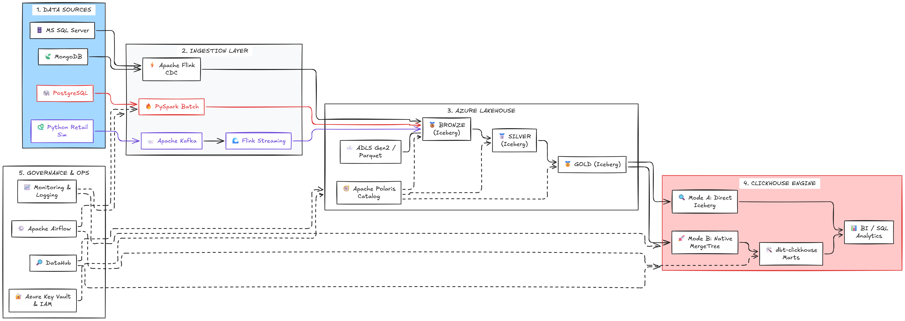

# Project Blueprint — Retail Enterprise Lakehouse Platform

**Version:** Draft v1.0  
**Date:** 2026-11-07  
**Status:** Planning baseline; requirements and compatibility gates remain open.

## 1. Executive summary

The project builds a small-scale but enterprise-inspired retail data platform combining Azure object storage with open-source data engineering technologies. It ingests structured data from SQL Server and PostgreSQL, semi-structured customer data from MongoDB, and business events emitted by a Python Retail Application Simulator.

The platform supports three distinct ingestion patterns:

- Batch ingestion using PySpark.
- Database Change Data Capture (CDC) using Apache Flink CDC.
- Business event streaming using Kafka and Apache Flink.

All ingested data is organized into Bronze, Silver, and Gold Iceberg tables stored in ADLS Gen2. Gold contains the canonical dimensional model. ClickHouse is the only query engine. It first queries selected Gold Iceberg tables directly; a controlled benchmark then compares those queries with selected native ClickHouse MergeTree tables or aggregates.

## 2. Business scenario

A multi-channel retail organization operates separate systems for transactional sales, product/store reference data, and customer profiles. It also produces customer-interaction events through its digital retail channel. Business users need trusted, integrated analytics across sales, customers, products, stores, and time.

The platform must retain source history where required, standardize heterogeneous data, preserve changes, produce a dimensional model, and expose analytical datasets without copying everything into another warehouse by default.

## 3. Goals

1. Demonstrate multi-source data ingestion from relational and document databases.
2. Demonstrate batch, CDC, and event-driven streaming patterns.
3. Build an open lakehouse on ADLS Gen2 using Apache Iceberg and a shared catalog.
4. Implement Medallion layers with explicit data contracts and quality rules.
5. Build a retail Star Schema: Fact Sales and Product, Customer, Store, and Date dimensions.
6. Implement and test SCD Type 1 and Type 2 for selected dimensions.
7. Use ClickHouse as the only SQL query engine.
8. Compare direct Iceberg querying with selective MergeTree materialization using repeatable benchmarks.
9. Orchestrate finite workflows and scheduled jobs with Airflow.
10. Provide metadata discovery and lineage with DataHub.
11. Demonstrate security, observability, recovery, and data reconciliation appropriate to a lab/portfolio platform.

## 4. Non-goals

- Building a complete customer-facing retail website.
- Replacing the operational source databases.
- Building a second warehouse platform such as Synapse Dedicated SQL Pool.
- Running Trino in the MVP.
- Replicating every Gold table into ClickHouse.
- Claiming production HA, enterprise SLAs, or regulatory compliance from a small-scale lab.
- Adding tools solely to increase the number of technologies in the stack.

## 5. Users and use cases

### Data Engineer
- Inspect source schemas and ingestion status.
- Run or backfill batch loads.
- Monitor CDC lag and streaming checkpoints.
- troubleshoot rejected records and schema drift.
- Reprocess a Bronze range after fixing transformation logic.

### Analytics Engineer
- Review Gold dimensional tables.
- Build ClickHouse marts with dbt.
- Define data tests and model documentation.
- Compare direct-Iceberg and MergeTree query performance.

### Business Analyst / Retail Manager
- Query sales by date, product, customer segment, and store.
- Review revenue, units, discounts, profit, and order trends.
- Analyze customer activity and conversion events.

### Platform Operator
- Review Airflow runs and Flink job health.
- Inspect storage usage, job failures, and data freshness.
- Manage credentials, roles, and retention policies.

## 6. Source systems and provisional ownership

| Source | Example entities | Provisional ingestion | Primary tool |
|---|---|---|---|
| Microsoft SQL Server | Orders, OrderItems, Payments | CDC for selected transactional tables; batch snapshot/backfill as needed | Flink CDC; PySpark JDBC for backfill if required |
| PostgreSQL | Products, Stores, Categories, InventorySnapshots | Scheduled batch initially; CDC may be adopted for selected high-change tables | PySpark JDBC |
| MongoDB | CustomerProfiles, Preferences, LoyaltyProfiles | CDC for selected collections | Flink CDC MongoDB source |
| Python Retail Simulator | ProductViewed, CartItemAdded, CheckoutStarted, OrderPlaced (event contract to be finalized) | Event streaming | Python producer → Kafka → Flink |

This is a design allocation, not a restriction of database capabilities. Ingestion mode is selected per dataset/table/collection based on freshness, volume, source capabilities, and operational cost. PostgreSQL supports CDC in Flink CDC as well; it is assigned batch only as a provisional project choice.

## 7. Proposed technology stack

| Concern | Proposed technology | Responsibility |
|---|---|---|
| Cloud object storage | Azure Data Lake Storage Gen2 | Physical storage for Iceberg data and metadata files |
| File format | Apache Parquet | Columnar data files |
| Table format | Apache Iceberg | Table metadata, snapshots, schema/partition evolution, atomic table commits |
| Catalog | Apache Polaris | Shared Iceberg REST Catalog; verify compatibility and auth |
| Batch processing | Apache Spark / PySpark | Batch extraction, standardization, Silver/Gold modeling, backfills |
| Database CDC | Apache Flink CDC | Snapshot + continuous change capture for selected databases |
| Event backbone | Apache Kafka | Durable event transport and consumer decoupling |
| Stream processing | Apache Flink | Business-event validation, enrichment, windows, and Iceberg writes |
| Query engine | ClickHouse | Direct Iceberg SQL and native OLAP serving |
| Native serving storage | ClickHouse MergeTree | Selected performance-critical tables/aggregates only |
| SQL modeling | dbt-clickhouse | Models, tests, docs and marts inside ClickHouse |
| Orchestration | Apache Airflow | Scheduled batch, dbt, validation, reconciliation, maintenance workflows |
| Governance | DataHub | Technical metadata, ownership, glossary, lineage and discovery |
| Identity/secrets | Microsoft Entra ID + Azure Key Vault | Identity and secret management; actual access enforced at each service |
| Monitoring | Prometheus/Grafana and/or Azure Monitor | Metrics, dashboards, logs and alerts; exact selection open |
| BI | Superset or Power BI | Optional consumption layer; choose after requirements/cost review |

## 8. Logical data architecture

### 8.1 Bronze — source-aligned and replayable

Purpose: preserve ingested source data and event context with minimal business transformation.

Example tables:

- `bronze.sqlserver_orders_cdc_events`
- `bronze.sqlserver_order_items_cdc_events`
- `bronze.mongodb_customer_profile_events`
- `bronze.postgres_products_batch`
- `bronze.retail_app_events`

For CDC, preserve operation type, source position/offset where available, source timestamp, ingestion timestamp, source table/collection, and event key. Do not silently collapse all changes into a current-state table in Bronze. Define retention and privacy rules; Bronze is not automatically kept forever.

### 8.2 Silver — validated and conformed

Purpose: normalize types and schemas, deduplicate, handle deletes and late events, flatten selected MongoDB structures, apply quality rules, and create consistent entities.

Example tables:

- `silver.orders`
- `silver.order_items`
- `silver.products`
- `silver.customers`
- `silver.stores`
- `silver.retail_events`

Silver should have explicit keys, nullability, accepted values, event ordering rules, and current-state/history semantics. Separate append-only event history from current-state tables when both are needed.

### 8.3 Gold — canonical analytical model

Purpose: provide business-ready data with documented grain and definitions.

Core model:

- `gold.fact_sales` — proposed grain: one row per order line.
- `gold.dim_product`
- `gold.dim_customer`
- `gold.dim_store`
- `gold.dim_date`

Optional aggregates are added only for a defined business query or benchmark. SCD Type 1 and Type 2 are applied per dimension attribute according to business semantics. Facts must reference the correct dimension surrogate key for the sale's business-effective time.

Gold Iceberg tables are the canonical analytical source of truth. ClickHouse copies, when created, are derived serving representations and must be reproducible from Gold.

## 9. ClickHouse query and serving design

### Mode A — direct Iceberg querying

- ClickHouse reads selected Gold Iceberg tables from ADLS.
- No full table copy is created by this query path.
- Use `icebergAzure()` / the Iceberg table engine for path-based access, or test `DataLakeCatalog` with Polaris for catalog discovery.
- Record ClickHouse version, Iceberg format version, ADLS endpoint/auth method, catalog mode, and feature flags in POC evidence.

### Mode B — selective native MergeTree materialization

- Choose one bounded benchmark dataset (for example, a selected date range of `gold.fact_sales`) and one aggregate (for example, daily sales by store/category).
- Load only those selected objects into ClickHouse MergeTree.
- Use a documented load mechanism, watermark/checkpoint, and idempotent reload strategy.
- Record freshness lag and reconciliation counts.
- Do not mirror all Gold tables by default.

### Benchmark dimensions

Compare the same business query and equivalent data range across both modes:

- p50/p95 query latency.
- rows and bytes scanned/read.
- ClickHouse CPU/memory and concurrency behavior.
- ADLS read volume and network effects where measurable.
- native storage consumed.
- load/refresh duration and freshness lag.
- operational complexity and failure recovery.

No speedup is assumed in advance. A native table is retained only if measured benefit justifies storage and maintenance.

## 10. Data quality and reliability

Minimum checks:

- Completeness: mandatory IDs and timestamps present.
- Uniqueness: source business key and order-line grain unique where expected.
- Validity: positive quantities; valid statuses; non-negative amounts where business rules require.
- Referential integrity: fact dimension keys resolve to a dimension row or an explicit Unknown member.
- Reconciliation: source/ingested/processed/Gold/ClickHouse counts and monetary totals reconcile within defined rules.
- Freshness: ingestion and publication lag within agreed target.
- CDC correctness: inserts, updates, deletes, snapshot-to-stream transition, restart and duplicate handling.
- Streaming correctness: event ID deduplication, event-time handling, late events and DLQ behavior.

Rejected records go to a quarantine area with a reason code and traceable source metadata. Quality results are published as run metadata, not mixed into business tables without a clear contract.

## 11. SCD and dimensional modeling policy

- Define grain and business keys before implementing dimensions.
- Use surrogate keys in the Gold dimensional model.
- Type 1 is used for attributes where only the latest corrected value matters.
- Type 2 is used only for attributes whose historical values are analytically meaningful (e.g., customer segment or store region if business requires historical attribution).
- Define `valid_from`, `valid_to`, `is_current`, and a deterministic change-detection strategy.
- Handle late-arriving dimensions and unknown keys.
- Ensure fact-to-dimension resolution uses the correct effective-time range.
- Validate reprocessing and idempotency.

## 12. Orchestration and runtime ownership

Airflow manages finite workflows:
- scheduled PySpark batch ingestion;
- batch backfills;
- Silver/Gold transformations when run as finite Spark jobs;
- dbt runs/tests;
- reconciliation;
- Iceberg maintenance;
- ClickHouse selective load/refresh and benchmark runs.

Flink CDC and event-streaming jobs are long-running applications managed by Flink deployment/runtime (local lab initially; cloud orchestration later if required). Airflow may trigger deployment or verify job health, but it does not process individual Kafka events or replace Flink checkpointing/recovery.

## 13. Security and governance

- Use managed identity/service principals where supported; keep credentials in Key Vault or a development secret manager.
- Apply least-privilege access to ADLS containers/paths, Polaris, Kafka, source databases, and ClickHouse independently.
- Use TLS for network connections and avoid secrets in source control or logs.
- Mask or synthesize personal customer data; the simulator should not use real personal information.
- DataHub is the metadata/lineage catalog, not the enforcement point for object-store or database permissions.
- Define retention, deletion, and backup policies for business data, logs, Kafka topics, and Iceberg snapshots.

## 14. Deployment strategy

Start with a reproducible development environment. Run local/open-source services in containers where practical, while using an Azure storage account for the lakehouse POC if budget and network access allow. A small Azure VM/container host may be used for a cloud-style deployment demonstration. AKS is not required in the MVP.

Separate at least:
- local development;
- integration/QA environment;
- Azure resource environment.

A single-node environment is a learning lab, not an HA deployment. Document resource sizing, cost guardrails, shutdown/deallocation steps, and data cleanup.

## 15. Project phases

1. Discovery: dataset choice, source ownership, business rules, volumes, freshness, Azure budget, security constraints.
2. Compatibility POCs: ADLS + Iceberg + Polaris; Spark and Flink catalog access; ClickHouse direct reads; ClickHouse native load; Flink CDC source versions.
3. Foundation: repository, containers, source databases, storage, catalog, secrets, network.
4. Source simulation and ingestion: Python simulator, Kafka topics, batch and CDC pipelines.
5. Bronze: source-aligned Iceberg tables, checkpoints, metadata and replay.
6. Silver: normalization, CDC state handling, data quality, quarantine.
7. Gold: dimensional model, SCD1/SCD2, reconciliation.
8. ClickHouse: direct Iceberg query benchmark and selective MergeTree benchmark.
9. dbt and consumption: ClickHouse marts, tests, docs and BI demo.
10. Governance and operations: DataHub, lineage, Airflow, monitoring, maintenance, access controls.
11. Final hardening: failure recovery, backfills, performance and cost report.
12. Portfolio delivery: architecture diagrams, demo, repository documentation and benchmark evidence.

## 16. Definition of Done

A phase is complete only when:
- its deliverables exist in the repository;
- acceptance tests are documented and executed;
- data counts and business metrics reconcile;
- failures and restart scenarios have been exercised where relevant;
- secrets are not committed;
- architecture and ADR documentation are updated;
- actual versions and test evidence are recorded;
- no unverified performance or reliability claim is made.

## 17. Open questions

- Which retail dataset will seed the three operational stores?
- Which source tables/collections are CDC versus batch at table level?
- Which SQL Server, PostgreSQL, and MongoDB versions will be used? Connector compatibility must drive this choice.
- Which attributes require SCD2 history?
- What are the target freshness/latency expectations for CDC and app events?
- Which Azure region, account type, budget, and deployment host are available?
- Is DataHub required in the MVP or added after the core ingestion/modeling path works?
- Which BI client will consume ClickHouse?
